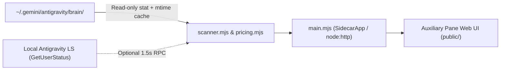

# Swarm Cost Monitor

> **Zero-dependency Antigravity UI plugin** for real-time per-Swarm & per-Worker cost attribution, multi-model token breakdown, active conversation Context Window telemetry, and live Gemini / Claude account quota gauges.

[English](README.md) · [简体中文](README.zh-CN.md)


---

## Why Swarm Cost Monitor?

Account-level quota tools only show overall pool percentages. When running multi-agent **Swarms** or long conversations, you need to know **which Swarm, which Worker, and which Model** is burning your tokens and budget — plus how close your **current conversation** is to its context window limit.

**Swarm Cost Monitor** reads local Antigravity transcripts (`~/.gemini/antigravity/brain/`) directly in read-only mode, using **exact** `input_tokens`, `cache_read_tokens`, `output_tokens`, and per-step `model` records whenever available, and renders an Antigravity-native Auxiliary Pane dashboard with zero external dependencies or CDNs.

---

## Features

### 1. Swarm Cost & Multi-Model Attribution (`Swarm Cost` Tab)
- **Cross-Swarm Spend Share**: Automatic discovery of native Swarms (`.system_generated/swarm/`) and standalone subagent trees, showing each Swarm's share of total spend and tokens.
- **Per-Worker Breakdown**: Interactive SVG Donut Chart, stacked share bar, and sortable Worker cards (`coordinator`, workers, `monitor`, `narrator`).
- **Multi-Model Stacked Bars**: When a single Worker switches models mid-run (e.g., `Claude Opus 5.5` → `Gemini 4 Neon`), its bar renders stacked model-colored segments and expands to show per-model USD cost, token share, and call counts.
- **Metric Switcher & Timeline**: Toggle between **Cost (`$`)**, **Tokens**, and **Steps & Tools**, plus a cumulative spend timeline chart.

### 2. Current-Conversation Context Window (`Context Window` Tab)
- **Strictly Scoped to Active Conversation**: Tracks only the conversation open in the current pane (never mixes other threads).
- **Exact Fill Meter & Thresholds**: Displays `used / limit`, remaining headroom, 60% / 80% markers, cache-hit rate, and proactive `/compact` advice above 75%.
- **Composition Breakdown**: Breaks down active context into **System Prompt & Tool Schemas**, **Tool Calls & Outputs**, **Assistant Responses**, **Thinking / Reasoning**, **User Messages**, and **System Notices**.
- **Turn-by-Turn Growth Chart & Tool Definitions Inspector**: Visualizes context growth + compaction markers across turns, ranks which **built-in tools, skills, rules, and MCP servers** consume the most definition tokens, and includes a **View All** drawer with category filters, By-Plugin grouping, and live search.

### 3. Docked Live Quota Monitor & Settings
- **Bottom-Left Dock (Directly Above Settings)**:
  - **Mini**: Twin 3/4-circle (270°) SVG arc gauges for **Gemini 5h** (`G`) and **Claude 5h** (`C`) with color-coded health & reset countdown tooltips.
  - **Compact**: Two-column horizontal progress bars with live countdowns.
  - **Expanded**: Full multi-bar panel with plan tier, AI Prompt/Flow credits, collapsible 27-model list, and optional **Weekly Quota / 7-Day Local Usage** (`Show Weekly Quota` toggle).
- **Smart Adaptive Polling**: Refreshes every 5s while any Swarm/session is active, automatically backs off to 30s when idle, and skips redundant DOM updates so gauges never flicker.
- **Bilingual UI (`中文` / `English`)**: Instant switch inside Settings, persisted atomically across sessions.

---

## Architecture



---

## Installation

### Quick Install (Recommended)

**Windows (PowerShell):**
```powershell
git clone https://github.com/Mekathun/antigravity-swarm-cost-monitor.git
cd antigravity-swarm-cost-monitor
.\install.ps1
```

**macOS / Linux:**
```bash
git clone https://github.com/Mekathun/antigravity-swarm-cost-monitor.git
cd antigravity-swarm-cost-monitor
chmod +x install.sh && ./install.sh
```

Then open **Customizations → Plugins** in Antigravity, enable **Swarm Cost Monitor**, and open the panel via:
```markdown
[Swarm Cost Monitor](sidecar://swarm-cost-monitor/swarm_cost/)
```

### Standalone Mode (Browser Preview)
```bash
cd sidecars/swarm_cost
PORT=43123 node main.mjs
# Open http://127.0.0.1:43123/?conversationId=<your-conversation-id>
```

---

## REST API

| Endpoint | Description |
| :--- | :--- |
| `GET /api/health` | Sidecar status, runtime mode (`sidecar_sdk` \| `standalone`), discovered Swarm count |
| `GET /api/overview[?conversationId=<id>&force=1]` | Cross-Swarm totals, Swarm list with shares, active conversation hint, live `quotas` |
| `GET /api/swarm?id=<swarmId>[&force=1]` | Detailed per-Worker breakdown, multi-model attribution, model distribution, timeline |
| `GET /api/context?conversationId=<id>[&force=1]` | Current conversation's active Context Window fill, composition, growth history, top steps |
| `GET /api/pricing` | Reference USD per 1M token pricing weights, model context limits, estimation rules |
| `GET /api/settings` / `POST /api/settings` | Persistent UI settings (`quotaWidgetSize`, `showWeeklyQuota`, `language`) |

---

## Privacy & Resource Footprint

- **100% Local & Read-Only**: Reads only your local `~/.gemini/antigravity/brain/` logs and optional local Language Server status (`127.0.0.1`). Zero external network requests, zero telemetry, zero CDNs.
- **Minimal Overhead**: Incremental `mtime + size` caching keeps cached scans under `0.1 ms` (~50–80 MB RSS, `< 0.1%` CPU).

---

## License

[MIT](LICENSE)
